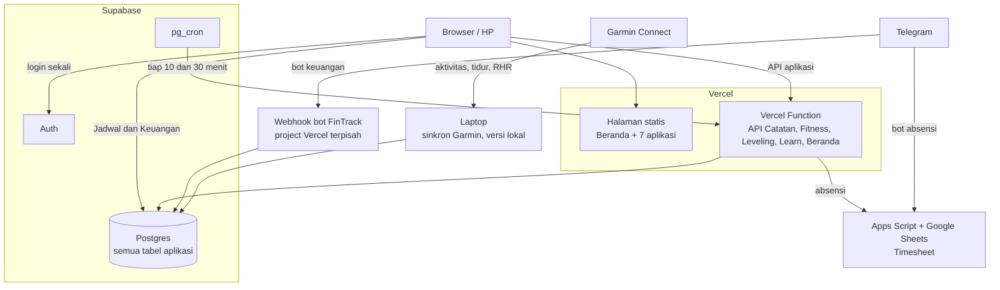
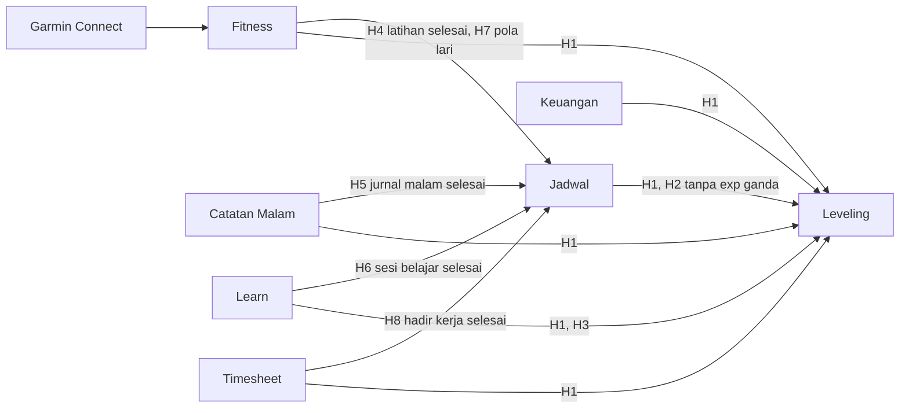
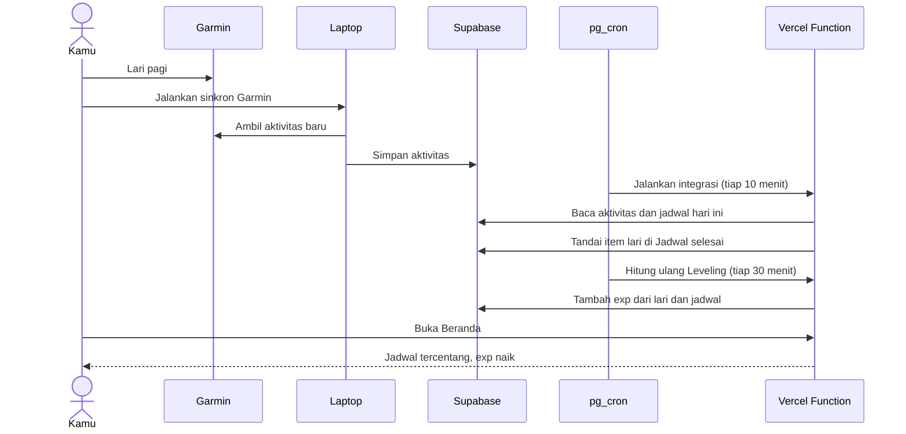

# Ionwyn System

[](https://github.com/himattheww/ionwyn-system/actions/workflows/test.yml)

Tujuh aplikasi pribadi yang digabung menjadi satu sistem: satu alamat, satu navigasi, satu login, satu database. Aktivitas di satu aplikasi ikut mengisi aplikasi lain, misalnya lari yang tercatat di Garmin otomatis mencentang jadwal lari dan menambah exp di Leveling.

- **Online:** di-deploy ke Vercel + Supabase, perlu login.
- **Lokal:** dijalankan di laptop dengan `npm start`, tanpa login.

Dua-duanya memakai database Supabase yang sama, jadi isinya selalu sama.

## Fitur

### Beranda
Rangkuman hari ini dari semua aplikasi dalam satu halaman: jadwal hari ini, status Catatan Malam, ringkasan latihan minggu ini, sesi belajar terakhir, level karakter, absensi, serta pengeluaran hari ini dan bulan ini dibanding budget. Di bawahnya ada status setiap hubungan antar-aplikasi (H4–H8) beserta tombol **Jalankan sekarang**.

### Jadwal (`/jadwal/`)
- Jadwal harian manual dan rutinitas mingguan yang diterapkan per minggu.
- Pengingat, geser jadwal, tandai selesai atau dilewati.
- Catatan realisasi (berapa km, berapa menit) yang dibaca aplikasi lain.
- Kolom **Tipe aktivitas** membuat item selesai sendiri dari aplikasi lain (lihat [Hubungan antar-aplikasi](#hubungan-antar-aplikasi)).
- Bisa dipasang sebagai PWA di HP.

### Catatan Malam (`/catatan/`)
- Satu jurnal per malam, dibuka pukul 18.00–02.00 WIB: apa yang terjadi, hal baik, pelajaran, catatan bebas.
- Kalender untuk melihat dan mengisi tanggal yang terlewat (ditandai sebagai susulan).
- Kumpulan **Pelajaran** dan **Hal baik** dari semua malam, bisa difilter per rentang tanggal.
- Pencarian kata di semua catatan.
- "Hari ini tahun lalu": catatan di tanggal yang sama pada tahun-tahun sebelumnya.

### Fitness (`/fit/`)
- Sinkron otomatis dari Garmin Connect: aktivitas, set latihan beban, tidur, RHR.
- Input manual: berat badan, makan (protein tercukupi, porsi nasi), kondisi (alkohol, sakit, catatan).
- Ringkasan minggu: hari lari sesuai pola, total km, sesi beban, rata-rata tidur, RHR, dan berat 7 hari.
- Grafik long run per minggu dengan garis target, riwayat beban per gerakan, halaman recovery.
- Laporan bulanan dibanding bulan sebelumnya.
- Pengaturan pola lari mingguan (misalnya Senin easy, Rabu tempo, Minggu long run). Pola ini otomatis menjadi rutinitas di Jadwal.

### Learn (`/learn/`)
- Jalur belajar untuk apa saja: coding (React, C#, three.js) maupun non-coding (public speaking, memasak, lari).
- **Dibuat lewat chat Claude.** Konektor Ionwyn membuat Claude bisa menyusun jalur lengkap dengan topik, penjelasan singkat, dan latihannya, lalu menyimpannya langsung ke sini. Bisa dari laptop maupun HP, tanpa API key (lihat [Konektor Claude (MCP)](#konektor-claude-mcp)).
- **Roadmap**: topik digambar sebagai peta yang terhubung sesuai prasyaratnya. Klik node untuk mulai belajar. Tampilan daftar tetap tersedia.
- **Per topik**: penjelasan singkat 2-4 paragraf, maksimal 3 sumber resmi (dicek masih hidup), dan satu latihan:
  - JavaScript: kode dijalankan di browser dengan test case (Web Worker, batas 3 detik);
  - bahasa lain dan praktik non-coding: daftar cek mandiri.
- **Tandai selesai** setelah latihan lulus. Sesi belajar tercatat otomatis (mencentang item belajar di Jadwal dan memberi exp di Leveling), lalu muncul tombol **Topik berikutnya**.
- **Saat semua topik selesai**, jalur ditandai selesai dan muncul prompt "Mau lanjut ke mana?" untuk ditanyakan ke Claude.
- Arsip dan hapus jalur.

### Leveling (`/leveling/`)
- Karakter ala RPG: level, tier, gelar, dan lima atribut yang dihitung dari aktivitas nyata di semua aplikasi.
- Orb three.js yang bentuknya mengikuti skor lima atribut.
- Log exp per kejadian, riwayat harian, pencapaian, dan halaman sumber yang menunjukkan aplikasi mana yang terbaca.
- **Cita-cita**: tulis yang ingin dicapai, pilih ukuran (kecil 100, sedang 300, besar 1000 exp) dan atributnya. Exp masuk saat ditandai tercapai dan tidak terkena batas harian.
- Aturan exp ada di `leveling/config/rules.json`. Item jadwal yang sudah dihitung di aplikasi asalnya tidak memberi exp ganda.

### Keuangan (`/uang/`)
- Transaksi pemasukan dan pengeluaran, transaksi berulang, budget per kategori, dan target tabungan.
- Dashboard, grafik, dan laporan bulanan yang bisa diekspor ke PDF.
- Jatah harian tetap: alokasi Utama + Jajan dibagi jumlah hari dalam bulan. Sisa jatah hari yang sudah lewat terkumpul di **Sudah menabung bulan ini**. Kalau belanja hari ini melewati jatah, kelebihannya langsung mengurangi angka itu, dan bisa berubah menjadi **Defisit bulan ini**.
- AI Analyst untuk membaca pola pengeluaran.
- Bot Telegram: catat transaksi dan cek saldo dari chat (`/add`, `/list`, `/saldo`, `/goals`, `/help`). Hubungkan akun dari menu **Telegram** di aplikasi.

### Timesheet (`/timesheet/`)
- Absensi harian: jam masuk, jam keluar, kegiatan, serta sakit, izin, atau cuti.
- Rekap bulanan dengan lembur, akhir pekan, dan hari libur. Datanya tersimpan di Google Sheets lewat Apps Script.
- Jam bisa diketik langsung (keyboard angka di HP, titik dua otomatis).
- Di aplikasi Android, notifikasi muncul 10 menit sebelum 8 jam kerja (plus istirahat) tercapai.
- Bot Telegram: `masuk 08.00`, `keluar 17.30`, `kegiatan ...`, `izin`, `rekap`. Bisa diberi tanggal di depan, misalnya `kemarin masuk 08.00`.

### Catat cepat (`/catat/`)
- Halaman ringkas untuk HP: catat pengeluaran (nominal, kategori Utama/Jajan/Lainnya, catatan) dan absen masuk/keluar dengan sekali tap.
- Pengeluaran langsung masuk ke Keuangan, absen langsung masuk ke Timesheet.
- Dipakai juga oleh shortcut aplikasi Android Ionwyn.

### Yang menyatukan semuanya
- **Satu login.** Versi online meminta login sekali dengan akun Supabase. Jadwal dan Keuangan ikut masuk dengan sesi yang sama.
- **Satu database.** Semua data aplikasi ada di satu project Supabase dengan RLS di setiap tabel.
- **Hubungan otomatis.** Supabase `pg_cron` menjalankan integrasi tiap 10 menit dan hitung ulang Leveling tiap 30 menit, walaupun laptop mati.
- **Satu kerangka, delapan suasana.** Semua aplikasi memakai kerangka desain yang sama di `design/`, tapi tiap aplikasi punya warna, huruf, dan satu gerakan khas sendiri.
- **Satu backup.** `npm run backup` menyimpan semua tabel, data Timesheet, dan semua `.env`.

## Alur sistem

### Komponen dan arah data



- Browser memuat halaman statis dari Vercel, login sekali ke Supabase Auth, lalu memanggil API aplikasi lewat satu Vercel Function. Jadwal dan Keuangan membaca Supabase langsung dari browser dengan sesi login yang sama.
- Semua data aplikasi ada di satu database Postgres. Timesheet tetap di Google Sheets lewat Apps Script.
- `pg_cron` di Supabase memanggil Vercel Function secara terjadwal untuk menjalankan integrasi dan menghitung ulang Leveling.
- Laptop mengambil data dari Garmin Connect dan menulisnya langsung ke database (cara lama). Chat Claude membaca dan menulis Learn lewat konektor MCP.
- Bot Telegram Keuangan berjalan di project Vercel FinTrack sendiri, bot Telegram Timesheet di Apps Script.

### Aplikasi saling mengisi



Panah ke Jadwal artinya item Jadwal dengan tipe aktivitas yang cocok ditandai selesai otomatis. Panah ke Leveling artinya aktivitas itu menjadi exp. Beranda membaca ringkasan dari semua aplikasi. Penjelasan tiap kode H ada di [Hubungan antar-aplikasi](#hubungan-antar-aplikasi).

### Contoh: dari lari pagi sampai exp naik



## Cara pakai

### Sehari-hari (online)
1. Buka alamat Vercel-mu dan login dengan akun Keuangan. Sesi tersimpan, jadi cukup sekali per browser.
2. **Pagi:** buka Beranda untuk melihat jadwal hari ini. Absen masuk lewat Timesheet atau bot Telegram.
3. **Siang:** catat pengeluaran di Keuangan atau lewat bot Telegram FinTrack.
4. **Sesudah latihan:** jalankan sinkron Garmin dari laptop (lihat di bawah). Item `run_done`, `strength_done`, atau `swim_done` di Jadwal tercentang sendiri dalam 10 menit.
5. **Sesudah belajar:** catat sesi di Learn. Item belajar di Jadwal ikut tercentang.
6. **Malam (18.00–02.00):** tulis Catatan Malam. Item `diary_done` tercentang.
7. Lihat Leveling untuk exp dan level yang bertambah dari semua kegiatan hari itu.

Supaya sebuah item Jadwal selesai otomatis, isi kolom **Tipe aktivitas** dengan salah satu tipe di tabel [Cara memakai H4–H8](#cara-memakai-h4h8).

### Yang hanya bisa dari laptop
Dua fitur ini butuh laptop. Hasilnya langsung terlihat di versi online karena databasenya sama.

| Fitur | Cara |
| --- | --- |
| Sinkron Garmin (cara lama) | `cd fitness-track` lalu `npm run garmin:sync`, atau tombol **Sinkron** di Fitness versi lokal. Butuh port database terbuka, jadi tidak jalan di jaringan yang memblokirnya |
| Login ulang Garmin | `cd fitness-track` lalu `npm run garmin:login`, kalau sinkron menampilkan "Perlu login ulang" |

### Menjalankan di laptop
Dari folder `ionwyn-system`:

```bash
npm start
```

Buka alamat yang tampil di terminal. Log semua bagian tampil di satu terminal dengan label per aplikasi. Hub menjalankan integrasi sendiri tiap 10 menit selama `npm start` hidup. Tekan `Ctrl+C` untuk berhenti.

## Prasyarat

- Node.js 24 LTS, minimal 24.15 (`node -v`)
- Project Supabase (tier gratis cukup)
- Opera GX atau Chrome untuk sinkron Garmin (lihat `fitness-track/README.md`)

## Pertama kali (lokal)

Semua perintah dijalankan dari folder `ionwyn-system` (cek dengan `pwd` di macOS atau `cd` di Windows; isinya harus ada `package.json`, `hub`, `scripts`).

```bash
npm run setup
```

Perintah ini menjalankan `npm ci` di root dan di setiap aplikasi.

Lalu siapkan konfigurasi:

```bash
cp .env.example .env
```

Di Windows PowerShell pakai `copy .env.example .env`. Isi `.env` (lihat bagian [Konfigurasi](#konfigurasi)), jalankan migrasi Supabase (lihat [Deploy](#deploy-ke-vercel--supabase), langkah 1–3), lalu build:

```bash
npm run build
```

Setelah mengubah kode frontend, jalankan `npm run build` lagi. Untuk satu aplikasi saja: `npm run build -- catatan` (nama: `catatan`, `fit`, `leveling`, `learn`, `jadwal`, `uang`, `timesheet`).

Pertama kali membuka versi lokal, login sekali di Jadwal atau Keuangan. Browser menyimpan sesi per alamat, jadi sesi lokal dan sesi online terpisah.

## Desain

Semua aplikasi memakai satu kerangka di `design/`: skala spasi, ukuran huruf, target sentuh 44 px, fokus yang selalu terlihat, dan navigasi dua tingkat (atas untuk pindah aplikasi, bawah untuk halaman di dalam aplikasi). Di atas kerangka itu, tiap aplikasi punya suasana sendiri:

| Aplikasi | Suasana | Gerakan khas |
| --- | --- | --- |
| Beranda | Buku lapangan, kertas hangat | Busur matahari sepanjang hari |
| Jadwal | Papan keberangkatan, gelap dan amber | Jam split-flap |
| Catatan | Langit malam | Bintang berkedip dan fase bulan asli |
| Fitness | Layar telemetri, lime di atas hitam | Batang tumbuh dan garis detak jantung |
| Learn | Atlas di atas perkamen | Rute putus-putus yang bergerak |
| Leveling | Grimoire, emas di atas ungu tua | Lingkaran rune berputar |
| Uang | Buku besar akuntan | Garis ganda tinta, batang pengeluaran bergaris miring |
| Timesheet | Kartu absen | Stempel status dan jam dinding |

| File | Isi |
| --- | --- |
| `design/tokens.css` | Kerangka bersama: spacing, ukuran teks, durasi animasi, nilai awal warna dan huruf (suasana Beranda) |
| `design/suasana.css` | Warna dan huruf tiap aplikasi, dipilih lewat `data-suasana` di `<html>`. Kontras teks minimal 4,5:1 |
| `design/fonts.css` + `design/fonts/` | Semua huruf self-hosted (Newsreader, IBM Plex, Barlow Condensed, Fraunces, Figtree, Archivo, JetBrains Mono, Spectral, Source Sans 3, Cinzel, Alegreya Sans, Source Serif 4, Public Sans, Special Elite). Browser hanya mengunduh huruf yang dipakai halaman itu |
| `design/base.css` | Dasar bersama: tipografi, `btn`, `field`, `tag`, `subnav`, `hero`, `panel`, `meter`, skeleton. Animasi mati otomatis kalau `prefers-reduced-motion` aktif |
| `design/system.css` | Satu file yang diimpor setiap aplikasi |

Di setiap aplikasi:
- `src/styles/app.css` mengimpor `design/system.css`, lalu stylesheet milik aplikasi itu.
- Style komponen ada di `src/styles/` dan dipasang dengan `<style scoped src="...">`, jadi komponen Vue hanya berisi template dan logika.
- Fungsi bantu (format, tanggal, API) ada di `src/lib/`. Composable Vue ada di `src/composables/`.

Leveling punya orb three.js (`leveling/web/src/lib/orb.ts`). Bentuknya mengikuti skor lima atribut dan dimuat terpisah (lazy), jadi tidak memperlambat halaman lain.

## Deploy ke Vercel + Supabase

Semua data ada di satu project Supabase. Versi lokal dan versi Vercel memakai database yang sama, jadi yang kamu kerjakan dari laptop langsung terlihat online.

| Bagian | Di Vercel | Di laptop |
| --- | --- | --- |
| Semua halaman | Statis di bawah `/catatan/`, `/fit/`, `/jadwal/`, dst. | `npm start` |
| API Catatan, Fitness, Leveling, Learn, Beranda | Satu Vercel Function (`vercel/api.ts`) | Proses per aplikasi |
| Sinkron Garmin | Otomatis tiap 3 jam dan tombol **Sinkron**, setelah login Garmin sekali dari aplikasi Android | `cd fitness-track` lalu `npm run garmin:sync` atau tombol Sinkron di versi lokal |
| Buat jalur Learn | Lewat chat Claude dengan konektor MCP | Sama, lewat chat Claude |
| Integrasi H4–H8 dan hitung ulang Leveling | `pg_cron` memanggil endpoint tiap 10 dan 30 menit | Hub menjalankan sendiri |

**Login.** Versi Vercel meminta login sekali dengan akun Supabase-mu, dan hanya akun pemilik yang diterima. Jadwal dan Keuangan ikut masuk dengan sesi yang sama. Versi lokal tetap tanpa login.

**Langkah pertama kali:**
1. Jalankan migrasi di SQL Editor Supabase, urut: `20261020100000_catatan_malam.sql`, `20261020101000_fitness.sql`, `20261020102000_leveling.sql`, `20261020110000_hub_status.sql`, `20261021090000_garmin_tokens.sql`, `20261023090000_learn_lessons.sql`, `20261023120000_learn_short_lessons.sql`, `20261024090000_learn_simple_mcp.sql`.
2. Isi `DATABASE_URL` di `.env` root dengan connection string **Session pooler** (Supabase → Connect, port 5432). Transaction pooler (6543) macet saat query paralel.
3. Pindahkan data lama dari SQLite: `node --env-file=.env scripts/migrate-sqlite.mjs`. Aman diulang, tidak membuat duplikat.
4. Di Vercel: import repo ini. `vercel.json` sudah mengatur install dan build. Isi Environment Variables:

   | Variabel | Isi |
   | --- | --- |
   | `DATABASE_URL` | connection string Session pooler (port 5432) |
   | `OWNER_USER_ID` | id user Supabase-mu |
   | `INTERNAL_SECRET` | string acak panjang buatanmu sendiri, sama dengan yang dipakai `pg_cron` |
   | `HUB_APP_BASE` | `https://<domain-vercel-mu>` |
   | `FINANCE_SUPABASE_URL`, `FINANCE_SUPABASE_KEY`, `FINANCE_EMAIL`, `FINANCE_PASSWORD` | sama dengan `.env` root |
   | `SCHEDULE_SUPABASE_URL`, `SCHEDULE_SUPABASE_KEY`, `SCHEDULE_EMAIL`, `SCHEDULE_PASSWORD` | sama dengan `.env` root |
   | `TIMESHEET_API_URL`, `TIMESHEET_API_KEY` | sama dengan `.env` root |
   | `SUPABASE_URL`, `SUPABASE_SERVICE_ROLE_KEY` | untuk Learn, sama dengan `learning/server/.env` |
   | `SUPABASE_ANON_KEY` | anon key, untuk build Jadwal |
   | `VITE_SUPABASE_URL`, `VITE_SUPABASE_ANON_KEY` | untuk build Keuangan |
   | `LEARN_API_URL` | `https://<domain-vercel-mu>/learn` |
   | `FIT_ENABLED`, `DIARY_ENABLED`, `LEARN_ENABLED`, `SCHEDULE_ENABLED`, `FINANCE_ENABLED`, `TIMESHEET_ENABLED` | `true` |
   | `ALERT_TELEGRAM_TOKEN`, `ALERT_TELEGRAM_CHAT_ID` | opsional, untuk notifikasi error (lihat [Monitoring](#monitoring)) |
5. Setelah deploy pertama, isi `__DOMAIN__` dan `__INTERNAL_SECRET__` di `supabase/cron/jadwal-otomatis.sql`, lalu jalankan di SQL Editor. Rahasianya disimpan di Supabase Vault, bukan di teks job. Setelah itu jalankan juga `supabase/cron/garmin-sinkron.sql` untuk sinkron Garmin tiap 3 jam.
6. Di Supabase → Authentication → Sign In / Providers, matikan pendaftaran user baru.

Cek build Vercel di laptop tanpa deploy: `node scripts/build-vercel.mjs`. Hasilnya di `.vercel/output` (tidak masuk git).

## Struktur folder

```
ionwyn-system/
├── package.json             setup, build, start, backup, test
├── .env.example             contoh konfigurasi root (tanpa nilai rahasia)
├── scripts/
│   ├── apps.mjs             daftar aplikasi dan base path
│   ├── run.mjs              npm start: menjalankan semua bagian
│   ├── build.mjs            npm run build: build semua frontend dengan base path-nya
│   ├── setup.mjs            npm run setup: npm ci di semua folder
│   ├── backup.mjs           npm run backup
│   ├── test.mjs             npm test: semua tes dan typecheck
│   ├── screenshots.mjs      screenshot halaman utama (dipakai untuk cek tampilan)
│   └── compare-screenshots.mjs
├── hub/
│   ├── src/                 gateway, integrasi, API Beranda
│   └── web/                 shell navigasi dan halaman Beranda
├── catatan-malam/  fitness-track/  learning/  leveling/
├── reminder-and-scheduling/  financetracker/  timesheet/
├── backups/                 (tidak di git)
└── docs/audit.md            audit dan rancangan
```

## Supabase dan login

Jadwal, Learn, dan Keuangan memakai **satu project Supabase** (project FinTrack). Skema Jadwal dan Learn ditambahkan lewat `supabase/migrations/20261019230000_gabung_jadwal_learn.sql`.

- **Login sekali.** Jadwal dan Keuangan memakai project dan alamat yang sama, jadi sesi login-nya juga sama. Login di salah satunya membuat yang lain ikut masuk, dan keluar di salah satunya ikut mengeluarkan yang lain.
- **Learn** membaca dan menulis lewat servernya sendiri. Tabelnya tidak bisa dibaca langsung dari browser.
- **Timesheet** tidak perlu mengisi Koneksi. `API_KEY` disimpan di `.env` root, dan web memanggil Apps Script lewat hub.
- Project Supabase lama milik Jadwal dan Learn tidak dipakai lagi. Datanya sudah dibackup sebelum digabung.

## Konektor Claude (MCP)

Server MCP Ionwyn berjalan di fungsi Vercel yang sama, di alamat `<alamat-vercel>/mcp`. Dari chat Claude (web, desktop, atau HP) kamu bisa membaca dan mengisi semua aplikasi:

| Aplikasi | Alat |
| --- | --- |
| Beranda | `today_summary`, `run_integrations` |
| Catatan Malam | `diary_tonight`, `diary_get`, `diary_month`, `diary_search`, `diary_collection`, `diary_save` |
| Fitness | `fitness_summary`, `fitness_activities`, `fitness_recovery`, `fitness_report`, `fitness_log`, `garmin_sync` |
| Leveling | `leveling_character`, `leveling_log`, `leveling_achievements`, `wish_list`, `wish_add`, `wish_achieve` |
| Jadwal | `schedule_list`, `schedule_add`, `schedule_complete`, `schedule_skip` |
| Keuangan | `finance_month`, `finance_add` |
| Timesheet | `timesheet_month`, `timesheet_entry` |
| Learn | `list_tracks`, `get_track`, `get_topic`, `learning_progress`, `create_track`, `add_topics`, `update_topic`, `set_track_status` |

Alat-alat ini memanggil API aplikasi yang sudah ada (`learning/server/src/systemTools.ts`), jadi aturannya sama dengan di aplikasi: jam buka Catatan Malam, validasi Fitness dan Jadwal, kategori Keuangan. Tidak ada alat untuk menghapus data. Hapus hanya dari aplikasi.

Jadwal dan Keuangan mendapat endpoint baru di hub untuk ini: `/hub/api/schedule` (daftar, tambah, selesai, lewati) dan `/hub/api/finance?month=` (ringkasan bulan). Pencatatan cepat `/hub/api/quick/expense` sekarang menerima pemasukan juga (`type: income`).

**Keamanan.** Konektor memakai OAuth 2.1 dengan PKCE dari SDK MCP resmi (`learning/server/src/oauth.ts`):
- Claude mendaftar sebagai klien. Alamat redirect hanya diterima dari `claude.ai`, `claude.com`, atau `localhost`.
- Saat menghubungkan, kamu login di Ionwyn lalu menekan **Izinkan**. Hanya akun pemilik (`OWNER_USER_ID`) yang bisa memberi izin.
- Token akses berlaku 1 jam dan refresh token 90 hari, dirotasi setiap dipakai. Di database hanya tersimpan hash-nya (`mcp_tokens`).

**Cara memasang di Claude:**
1. Di claude.ai, buka **Settings → Connectors → Add custom connector**.
2. Isi nama `Ionwyn` dan URL `<alamat-vercel>/mcp`. Biarkan **Sign in now** dan **Register automatically**, lalu simpan.
3. Klik **Connect**. Halaman login Ionwyn terbuka. Login, lalu tekan **Izinkan**.
4. Di chat baru, aktifkan konektornya, lalu minta misalnya "Rangkum hariku dari Ionwyn", "Catat pengeluaran jajan 25 ribu", atau "Buatkan jalur belajar React untuk pemula, 4 jam per minggu".

Konektor yang dipasang di claude.ai juga ikut muncul di aplikasi Claude di HP.

### Sinkron Garmin

Ada dua cara, dan keduanya menulis ke tabel yang sama:

| | Cara lama (laptop) | Cara baru (online) |
| --- | --- | --- |
| Login | `npm run garmin:login`, sesi disimpan di profil browser `.garmin-profile` | Halaman **Sinkron** di Fitness, tombol **Login Garmin** di aplikasi Android. Halaman login resmi Garmin terbuka di aplikasi |
| Mengambil data | Browser di laptop (Playwright) | Server Vercel dengan token Garmin yang disimpan di `fit_garmin_tokens` |
| Jalan otomatis | Saat `npm start` hidup, sekali sehari | `pg_cron` tiap 3 jam |
| Kalau sesi habis | Jalankan `npm run garmin:login` lagi | Status sinkron menampilkan "Perlu hubungkan Garmin lagi", login ulang dari aplikasi |

Cara baru tidak resmi: memakai alur login aplikasi Garmin Connect, sama seperti library `garminconnect`. Kalau Garmin mengubah alur loginnya, cara lama tetap bisa dipakai.

## Konfigurasi

Ada dua tingkat:

**`.env` root**, untuk hal yang dipakai bersama:

| Variabel | Fungsi |
| --- | --- |
| `HUB_PORT`, `CATATAN_PORT`, `LEARN_API_PORT`, `FIT_PORT`, `LEVELING_PORT` | Port versi lokal. Biarkan default kalau tidak bentrok |
| `DATABASE_URL` | Connection string Supabase **Session pooler** (port 5432). Dipakai Catatan Malam, Fitness, Leveling, dan backup |
| `OWNER_USER_ID`, `INTERNAL_SECRET`, `HUB_APP_BASE` | Hanya untuk versi Vercel. Lokal boleh kosong |
| `ALERT_TELEGRAM_TOKEN`, `ALERT_TELEGRAM_CHAT_ID` | Bot dan chat Telegram untuk notifikasi error. Kosong berarti notifikasi mati |
| `BACKUP_FOLDER` | Folder backup, default `backups` di root |
| `BACKUP_KEEP` | Jumlah backup harian yang disimpan, default 30 |
| `INTEGRATION_INTERVAL_MIN` | Siklus integrasi otomatis di versi lokal, default `0` (mati) karena `pg_cron` online sudah menjalankannya tiap 10 menit. Kalau versi lokal dan online sama-sama menjalankan integrasi, status di Beranda bolak-balik dan notifikasi Telegram terkirim berulang |
| `RUN_ROUTINE_DURATION_MIN` | Durasi rutinitas lari baru yang dibuat dari pola Fitness (H7) |
| `SCHEDULE_SUPABASE_URL`, `SCHEDULE_SUPABASE_KEY`, `SCHEDULE_EMAIL`, `SCHEDULE_PASSWORD` | Akun Jadwal untuk hub dan Leveling. Sejak Supabase digabung, isinya sama dengan `FINANCE_*`. Key = anon key |
| `FINANCE_SUPABASE_URL`, `FINANCE_SUPABASE_KEY`, `FINANCE_EMAIL`, `FINANCE_PASSWORD` | Akun Keuangan. Dipakai Beranda, Leveling, dan backup. Key = anon key |
| `TIMESHEET_API_URL`, `TIMESHEET_API_KEY` | URL web app Apps Script (berakhiran `/exec`) dan `API_KEY`-nya. Sama dengan isian Koneksi di web Timesheet |

`npm start` menyuntik nilai ini ke setiap aplikasi sebagai environment proses. Nilai dari environment selalu menang atas `.env` milik aplikasi. Port dan folder backup cukup diatur di sini.

**`.env` per aplikasi**, untuk rahasia milik aplikasi itu sendiri:

| File | Isi |
| --- | --- |
| `fitness-track/.env` | Pengaturan Garmin (`GARMIN_BROWSER_PATH`, `GARMIN_HEADLESS`, `GARMIN_PROFILE_DIR`), `TARGET_LONG_RUN_KM` |
| `learning/server/.env` | Supabase Learn (service role), pengaturan AI |
| `leveling/.env` | Sumber mana yang aktif (`*_ENABLED`), `DESKTOP_NOTIFICATION` |
| `reminder-and-scheduling/.env` | Supabase Jadwal untuk build web |
| `financetracker/.env` | Supabase Keuangan untuk build web |

`PORT`, `ALLOW_LAN`, `DB_PATH`, dan `BACKUP_FOLDER` di `.env` aplikasi diabaikan saat jalan lewat `npm start`. Semua `.env` ada di `.gitignore`. Hanya file `.env.example` yang masuk git.

## Backup

```bash
npm run backup
```

Hasilnya di `backups/harian/<tanggal_jam>/`:
- `database/`: setiap tabel di schema `public` Supabase sebagai satu file JSON. Ini mencakup semua aplikasi: Jadwal, Learn, Keuangan, Catatan Malam (`catatan_entries`), Fitness (`fit_*`), dan Leveling (`leveling_*`).
- `timesheet.json`: semua bulan dari Apps Script.
- `env/`: salinan semua `.env`.

Hanya `BACKUP_KEEP` backup terbaru yang disimpan. Backup ini melengkapi backup harian bawaan Supabase, bukan menggantikannya.

Restore satu tabel: buka file JSON-nya, lalu masukkan lagi lewat SQL Editor Supabase atau script kecil dengan `postgres`. File SQLite lama dari sebelum migrasi ada di `backups/catatan-malam/` dan `backups/fitness-track/`. Untuk memindahkannya ulang, salin file itu ke `catatan-malam/data/catatan.db` atau `fitness-track/data/fitness.db`, lalu jalankan `node --env-file=.env scripts/migrate-sqlite.mjs`.

Folder `backups/` ada di laptop yang sama. Supaya aman dari laptop rusak, arahkan `BACKUP_FOLDER` ke folder yang tersinkron ke cloud.

## Hubungan antar-aplikasi

`pg_cron` di versi online menjalankannya tiap 10 menit. Versi lokal tidak ikut menjalankan otomatis (kecuali `INTEGRATION_INTERVAL_MIN` diisi), tapi bisa dipicu dari tombol **Jalankan sekarang** di Beranda. Hasil dan error terakhir tiap hubungan tampil di Beranda.

| | Hubungan | Cara kerja |
| --- | --- | --- |
| H1 | Leveling membaca semua sumber | Fitness dan Catatan Malam lewat tabel Postgres, Jadwal dan Keuangan lewat Supabase, Learn lewat API export-nya, Timesheet lewat Apps Script |
| H2 | Tanpa exp ganda | Item jadwal yang tipenya termasuk `disiplin.linkedActivityTypes` di `leveling/config/rules.json` tidak memberi exp disiplin. Exp-nya datang dari aplikasi asal faktanya |
| H3 | Leveling membaca Learn | Endpoint export baru di Learn |
| H4 | Garmin menyelesaikan item latihan | Item `run_done`, `strength_done`, `swim_done` |
| H5 | Catatan Malam menyelesaikan pengingat | Item `diary_done` |
| H6 | Sesi Learn menyelesaikan item belajar | Item `learn:<id jalur>` (jalur tertentu) atau `learn_done` (jalur apa pun) |
| H7 | Pola lari Fitness menjadi rutinitas lari | Rutinitas Jadwal bertipe `run_done` dibuat atau diperbarui dari Pengaturan pola lari Fitness |
| H8 | Hadir di Timesheet menyelesaikan item kerja | Item `work_done` |

### Cara memakai H4–H8

Isi kolom **Tipe aktivitas** di item atau rutinitas Jadwal:

| Tipe aktivitas | Selesai otomatis kalau |
| --- | --- |
| `run_done` | Ada aktivitas lari Garmin di tanggal itu |
| `strength_done` | Ada sesi `strength_training` di tanggal itu |
| `swim_done` | Ada aktivitas renang di tanggal itu |
| `diary_done` | Catatan Malam untuk tanggal itu tersimpan (sebelum 02.00 dihitung malam sebelumnya) |
| `learn:2` | Ada sesi Learn untuk jalur id 2 di tanggal itu (id terlihat di alamat `/learn/tracks/2`) |
| `learn_done` | Ada sesi Learn jalur apa pun di tanggal itu |
| `work_done` | Timesheet hari itu Hadir = Y dan jam masuk terisi |

Aturan:
- Hanya item `terencana` dalam 7 hari terakhir yang dicek.
- Item yang sudah selesai, dilewati, atau digeser tidak pernah diubah.
- Satu fakta hanya menyelesaikan satu item. Dua item lari di hari yang sama butuh dua aktivitas lari.
- Waktu selesai diisi waktu fakta itu terjadi, misalnya jam mulai lari. Log realisasinya berisi nilai nyata (km atau menit) dan `meta.source` + `meta.ref` asal faktanya.
- Penyelesaian ditulis lewat `completeItem` milik Jadwal (`reminder-and-scheduling/core`), dengan akun `SCHEDULE_EMAIL`.
- Item dari rutinitas baru bisa diselesaikan setelah rutinitas minggu itu diterapkan di Jadwal. Draf rutinitas belum punya baris di database.

H7 hanya mengubah judul dan status aktif rutinitas `run_done`. Jam dan durasi yang kamu ubah sendiri di Jadwal tetap dipertahankan.

### Kalau satu aplikasi mati

Hubungan yang membutuhkan aplikasi itu dilewati di siklus tersebut. Error-nya tercatat di Beranda dan di log terminal. Hubungan lain tetap jalan. Leveling memakai data terakhir dari sumber yang gagal dibaca.

## Monitoring

- **Status integrasi** H4–H8 disimpan di tabel `hub_integration_status`, jadi Beranda menampilkan hasil dan error terakhir walaupun fungsi Vercel baru dinyalakan ulang.
- **Notifikasi Telegram** dikirim saat:
  - sebuah integrasi berubah dari berhasil menjadi gagal, dan saat pulih lagi. Error yang sama tidak dikirim berulang;
  - API di Vercel melempar error. Paling banyak satu pesan per endpoint tiap 30 menit.
- Notifikasi aktif kalau `ALERT_TELEGRAM_TOKEN` dan `ALERT_TELEGRAM_CHAT_ID` diisi, di `.env` root untuk versi lokal dan di Environment Variables Vercel untuk versi online.

Cara mengisinya:
1. Buat bot baru lewat @BotFather di Telegram, lalu salin token-nya ke `ALERT_TELEGRAM_TOKEN`.
2. Kirim pesan apa saja ke bot itu dari akunmu.
3. Cari chat id-mu, misalnya lewat @userinfobot, lalu isi `ALERT_TELEGRAM_CHAT_ID`.

## Tes

```bash
npm test
```

Menjalankan tes hub, tes Catatan Malam, Fitness, Leveling, Jadwal (unit), dan typecheck semua aplikasi yang punya. Tes database memakai PGlite, jadi tidak butuh internet atau Supabase. Tes integrasi Jadwal ke Supabase tidak ikut, karena menulis ke database asli. Jalankan manual di `reminder-and-scheduling` dengan `npm test` kalau perlu.

GitHub Actions (`.github/workflows/test.yml`) menjalankan `npm run setup` dan `npm test` di setiap push ke `main` dan setiap pull request. Hasilnya terlihat dari badge di atas README dan tanda di samping setiap commit.

Cek tampilan (sebelum/sesudah perubahan):

```bash
node scripts/screenshots.mjs gateway sesudah
node scripts/compare-screenshots.mjs baseline sesudah
```

Login sekali dulu dengan `node scripts/screenshots.mjs gateway login --login`. Profil browser tes disimpan di `.screenshots/profile` (tidak di git).

## Perbedaan dari aplikasi aslinya

Semua perbedaan ini tidak mengubah tampilan:
- Frontend membaca base path dari `APP_BASE` saat build (`vite.config.ts`, router `createWebHistory(import.meta.env.BASE_URL)`, fetch API memakai `BASE_URL`). Tanpa `APP_BASE`, misalnya `npm run dev` atau deploy Vercel FinTrack, semuanya tetap di `/` seperti sebelumnya.
- Scheduling: service worker dan manifest memakai path relatif.
- FinTrack: `redirectTo` login Google dan reset password ikut base path. Tambahkan `<alamat>/uang/auth/callback` dan `<alamat>/uang/auth/reset-password` untuk alamat lokal dan alamat Vercel-mu di Supabase → Authentication → URL Configuration.
- Learn: server hanya bisa diakses dari laptop itu sendiri, plus endpoint export baru.
- Leveling: adapter Learn membaca API Learn, adapter Timesheet membaca Apps Script, aturan `linkedActivityTypes` (H2).

## Windows

Script root memakai Node saja (tanpa bash), dan proses dihentikan dengan `taskkill /T /F` di Windows. Yang perlu disesuaikan di Windows:
- `fitness-track/.env`: `GARMIN_BROWSER_PATH` ke `opera.exe`, atau kosongkan untuk Chrome.
- `learning/server/.env`: `CLAUDE_CLI_PATH` ke `claude.exe`.
- `SCREENSHOT_BROWSER_PATH` kalau memakai script screenshot.
